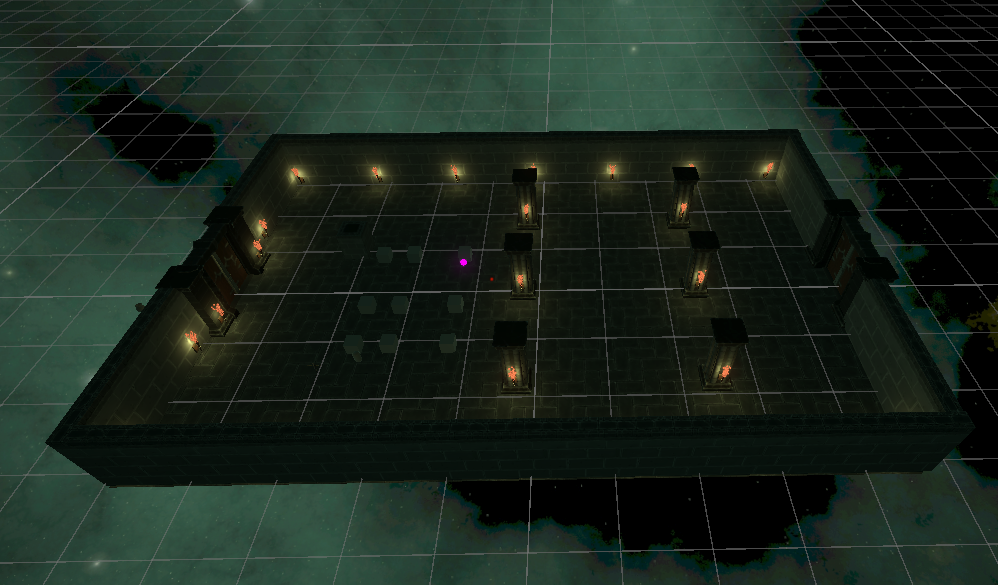

<h1 align = "center"> JamKiller </h1>

Developed with Unity 2022.3.44f1

This project is a further development of the game idea created during the Ludum Dare 55 game jam. The goal of this project is to explore the GOB/GOAP approach to game AI development, as well as to study ShaderGraph + VFX Graph.

